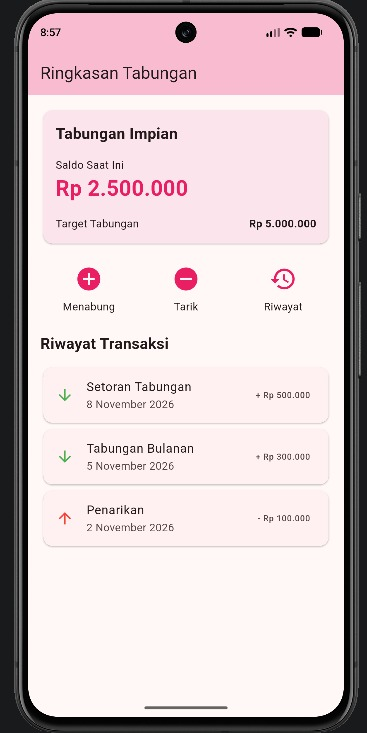
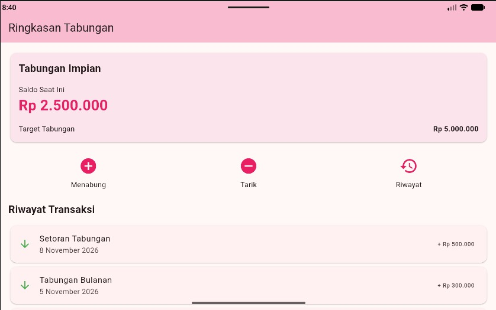

# TabungKu - Ringkasan Tabungan

Nama: Hanum Hawa Khumaira Awisno  
NIM: 20240801099  
Mata Kuliah: Pemrograman Mobile

## Deskripsi
TabungKu merupakan aplikasi Flutter sederhana
yang menampilkan ringkasan tabungan menggunakan
widget dasar Flutter.

Aplikasi ini menampilkan nama tabungan, saldo,
target tabungan, tiga menu utama, serta riwayat
transaksi dengan data statis.

## Cara Menjalankan Aplikasi
1. Buka project tabungku_layout di Android Studio.
2. Pastikan Flutter SDK sudah terkonfigurasi.
3. Jalankan emulator Android.
4. Buka file lib/main.dart.
5. Klik tombol Run untuk menjalankan aplikasi.

## Dokumentasi

### Tampilan pada Pixel 8

### Tampilan pada Small Tablet

